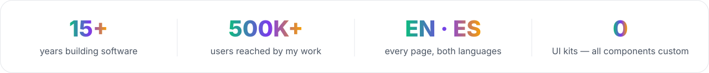
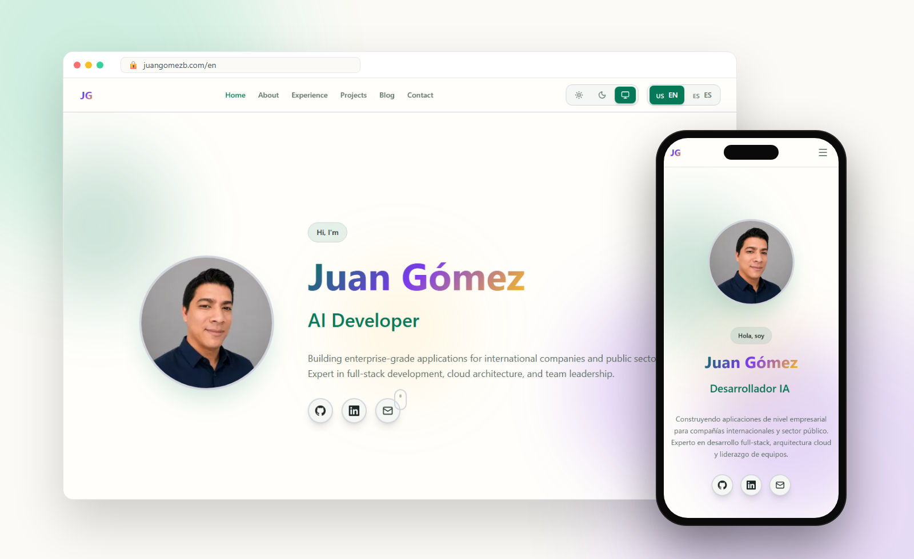
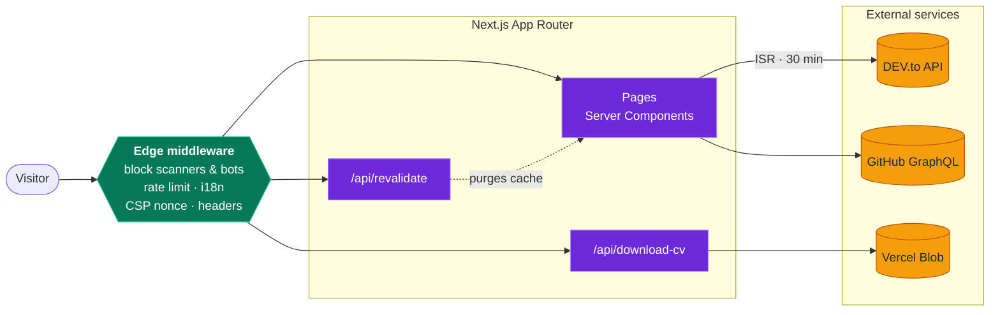
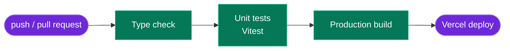

<div align="center">

<picture>
  <source media="(prefers-color-scheme: dark)" srcset="docs/readme/hero-dark.svg">
  
</picture>

<br><br>

<a href="https://www.juangomezb.com"></a>
<a href="https://dev.to/jgomezdev"></a>
<a href="https://www.linkedin.com/in/jcgomez89/"></a>

<a href="https://github.com/Juxn89/juangomezb/actions/workflows/ci.yml"></a>


<a href="LICENSE"></a>

</div>

<br>

<picture>
  <source media="(prefers-color-scheme: dark)" srcset="docs/readme/stats-dark.svg">
  
</picture>

<br><br>

The source of my personal site: a **bilingual Next.js 16 portfolio** rendered with React Server
Components, fed by my DEV.to articles and GitHub repositories, and **hardened at the edge** like a
production service — because a portfolio is also a sample of how I build.

<p align="center">
  <picture>
    <source media="(prefers-color-scheme: dark)" srcset="docs/readme/showcase-dark.png">
    
  </picture>
</p>

<p align="center"></p>

## ✦ What's inside

<table>
  <tr>
    <td width="50%" valign="top">
      <br>
      <b>Bilingual by design</b><br>
      <sub>English and Spanish on every route (<code>/en</code>, <code>/es</code>) with next-intl, <code>hreflang</code> alternates and a localized sitemap.</sub>
    </td>
    <td width="50%" valign="top">
      <br>
      <b>Light, dark or system</b><br>
      <sub>A three-way theme toggle over CSS variables of the <i>Forest Code</i> palette, remembered across visits.</sub>
    </td>
  </tr>
  <tr>
    <td valign="top">
      <br>
      <b>Blog from DEV.to</b><br>
      <sub>Articles fetched from the DEV API and cached with ISR for 30 minutes; a secured endpoint refreshes them on demand.</sub>
    </td>
    <td valign="top">
      <br>
      <b>Projects with case studies</b><br>
      <sub>Curated projects in both languages, validated with Zod, each with its own page: problem, decisions and measured results.</sub>
    </td>
  </tr>
  <tr>
    <td valign="top">
      <br>
      <b>Hardened edge</b><br>
      <sub>Scanner and bad-bot blocking, rate limiting, nonce-based CSP, HSTS and an origin shield — in middleware, before any page work.</sub>
    </td>
    <td valign="top">
      <br>
      <b>Search-ready</b><br>
      <sub>Per-page metadata, Open Graph, JSON-LD (<code>Person</code>, <code>WebSite</code>) and dynamic <code>sitemap.xml</code> / <code>robots.txt</code>.</sub>
    </td>
  </tr>
  <tr>
    <td valign="top">
      <br>
      <b>Mobile-first</b><br>
      <sub>Designed from 320&nbsp;px up; the same content in a single column on phones, with a dedicated menu.</sub>
    </td>
    <td valign="top">
      <br>
      <b>CV on demand</b><br>
      <sub><code>/api/download-cv?locale=en|es</code> serves the PDF in the visitor's language.</sub>
    </td>
  </tr>
</table>

## ✦ How a request flows



> [!TIP]
> Requests from scanners and blocked user agents end at the edge — they never reach a page, an API
> route or an external API. Only what needs the browser (theme, menus, animations) ships as client
> JavaScript; everything else renders on the server.

## ✦ Tech stack

<table>
  <tr>
    <th align="left">Frontend</th>
    <td>
      
      
      
      
      
      
    </td>
  </tr>
  <tr>
    <th align="left">Content &amp; i18n</th>
    <td>
      
      
      
      
    </td>
  </tr>
  <tr>
    <th align="left">Quality</th>
    <td>
      
      
      
      
    </td>
  </tr>
  <tr>
    <th align="left">Platform</th>
    <td>
      
      
      
      
      
    </td>
  </tr>
</table>

## ✦ Quick start

```bash
git clone https://github.com/Juxn89/juangomezb.git && cd juangomezb
pnpm install
pnpm dev            # → http://localhost:3000
```

<details>
<summary><b>Environment variables</b> — all optional for local development</summary>
<br>

Put them in `.env.local`:

| Variable | Used for | Without it |
|---|---|---|
| `NEXT_PUBLIC_SITE_URL` | Canonical URLs, sitemap, robots | Falls back to `https://juangomezb.com` |
| `REVALIDATE_SECRET` | Protects `POST /api/revalidate` | The endpoint refuses every request |
| `ORIGIN_SHIELD_SECRET` | Only requests through the CDN (header `x-origin-shield`) reach the app | The origin is reachable directly |

</details>

<details>
<summary><b>Scripts</b></summary>
<br>

| Command | What it does |
|---|---|
| `pnpm dev` | Development server (Turbopack) |
| `pnpm build` · `pnpm start` | Production build · production server |
| `pnpm lint` | ESLint |
| `pnpm test` · `pnpm test:watch` · `pnpm test:coverage` | Unit tests (Vitest) · watch mode · coverage of `src/lib` |
| `pnpm test:e2e` · `pnpm test:e2e:ui` | Playwright end-to-end tests · in UI mode |
| `pnpm ci` | Unit tests, then a production build |

</details>

## ✦ Quality gate



- **Unit tests** (`src/**/*.test.ts`): the DEV.to and GitHub clients, SEO metadata and utilities.
- **End to end** (`tests/e2e`): home page, navigation and both locales in a real browser.
- **CI** ([`.github/workflows/ci.yml`](.github/workflows/ci.yml)): a failing check stops the build.

## ✦ Security at the edge

| Layer | What it stops |
|---|---|
| 🚫 **Scanner paths** | Probes for `/.env`, `/.git`, WordPress, PHP admin panels… never reach the app |
| 🤖 **Bad user agents** | Known scanners and exploitation tools (nikto, nmap, nuclei, ZAP…) |
| ⏱️ **Rate limiting** | 100 requests / 15 min per IP for pages, 5 for API routes |
| 🔐 **CSP with a per-request nonce** | Injected scripts: no `unsafe-inline` in production |
| 🛡️ **Security headers** | Clickjacking, MIME sniffing, downgrade (HSTS), unneeded browser APIs |
| 🧱 **Origin shield** | Traffic that bypasses the CDN (404 without the shared secret) |
| 🔑 **Constant-time secret checks** | Timing attacks on the origin-shield header and the revalidation token |

Everything lives in [`middleware.ts`](middleware.ts). Background and decisions:
[docs/security-hardening.md](docs/security-hardening.md) · [docs/summaries](docs/summaries).

## ✦ Project structure

<details>
<summary>Show the tree</summary>

```
├── messages/                # en.json · es.json — every UI string
├── src/
│   ├── app/
│   │   ├── [locale]/        # Localized pages, layout, error and 404
│   │   │   └── projects/    # Project index and /projects/[slug] case studies
│   │   ├── api/             # revalidate · download-cv
│   │   ├── sitemap.ts       # Multilingual sitemap
│   │   └── robots.ts
│   ├── components/
│   │   ├── sections/        # Hero, About, Experience, Projects, Blog
│   │   ├── layouts/         # Header, Footer, MobileMenu
│   │   └── ui/              # Button, Card, Badge, ThemeToggle, LocaleSwitcher…
│   ├── lib/
│   │   ├── api/devto.ts     # DEV.to client (ISR)
│   │   ├── projects/        # Project model, Zod schema and accessors
│   │   ├── constants/       # Site URL, GitHub profile, home sections
│   │   ├── hooks/           # Section navigation shared by the header and mobile menu
│   │   ├── context/         # Theme context
│   │   └── utils/           # cn, SEO helpers
│   ├── proxy.ts             # Blocking, rate limiting, CSP nonce, i18n routing
│   └── i18n.ts · routing.ts # next-intl configuration
├── tests/e2e/               # Playwright
├── scripts/readme/          # Generates the artwork of this README
└── docs/                    # Plans, security notes, transcripts
```

</details>

## ✦ Deployment

Deployed on **Vercel** from `main` (Node 24, `pnpm build`), with the environment variables above in
*Settings → Environment Variables*. A new DEV.to article shows up within 30 minutes; to publish it
right away:

```bash
curl -X POST "https://www.juangomezb.com/api/revalidate" \
  -H "Authorization: Bearer $REVALIDATE_SECRET"
```

## ✦ Documentation

| | Document | Purpose |
|---|---|---|
| 🧭 | [SETUP.md](SETUP.md) | Step-by-step setup after cloning |
| 🧠 | [DEVELOPMENT.md](DEVELOPMENT.md) | Decisions, problems and their solutions |
| 🛠️ | [README.dev.md](README.dev.md) | Developer notes (Spanish): commands, integrations, gotchas |
| 📜 | [CHANGELOG.md](CHANGELOG.md) | Version history |
| 🤖 | [AGENTS.md](AGENTS.md) | Rules for the AI coding agents that work on this repo |
| 💬 | [CONVERSATION_HISTORY.md](CONVERSATION_HISTORY.md) · [docs/transcripts](docs/transcripts) | How it was built with AI assistance |
| 🗺️ | [docs/plans](docs/plans) | Implementation plans |

<p align="center"></p>

<div align="center">

### Let's build something

<a href="https://www.juangomezb.com"></a>
<a href="https://www.linkedin.com/in/jcgomez89/"></a>
<a href="https://github.com/Juxn89"></a>
<a href="https://dev.to/jgomezdev"></a>
<a href="mailto:gb.jc@outlook.com"></a>

<sub>Code under the <a href="LICENSE">MIT License</a> · Artwork generated by <a href="scripts/readme/build-assets.mjs"><code>scripts/readme/build-assets.mjs</code></a></sub>

</div>
